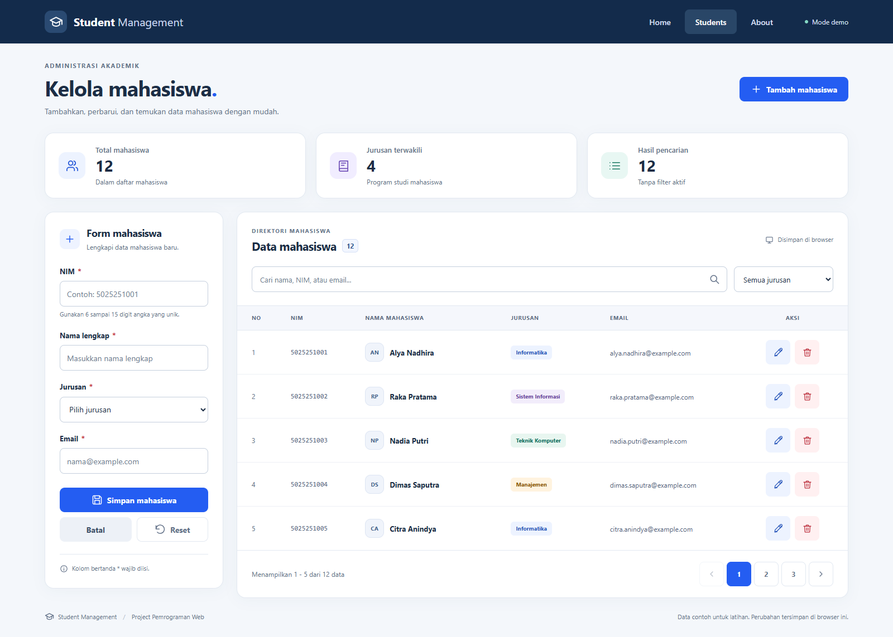

# PWEB Student Management

Project Pemrograman Web untuk membuat UI Student Management menggunakan HTML, CSS, dan JavaScript. Website memiliki form mahasiswa di sebelah kiri, direktori mahasiswa di sebelah kanan, serta layout responsif untuk layar kecil.

**Demo:** https://boyeep.github.io/PWEB-Student-Management/



## Fitur

- Form NIM, nama lengkap, jurusan, dan email.
- Tambah, edit, dan hapus mahasiswa dengan dialog konfirmasi.
- Validasi input wajib, email, dan NIM unik dengan 6 sampai 15 digit.
- Tombol batal dan reset. Reset mengosongkan kolom tanpa keluar dari mode edit; batal keluar dari mode edit.
- Pencarian berdasarkan nama, NIM, jurusan, atau email.
- Filter jurusan yang dapat digabungkan dengan pencarian.
- Pagination dengan 5 mahasiswa pada setiap halaman.
- Ringkasan jumlah mahasiswa, jurusan terwakili, dan hasil pencarian.
- Penyimpanan perubahan melalui localStorage.
- Navigasi keyboard, skip link, label formulir, dan reduced motion.

Data awal berisi **12 mahasiswa fiktif**. Aplikasi merupakan latihan frontend. Data tersimpan pada browser dan perangkat yang digunakan, tanpa backend atau sinkronisasi antarpengguna.

## Menjalankan project

Buka `index.html` di browser modern. Untuk menggunakan server lokal, jalankan perintah berikut dari folder project:

```powershell
python -m http.server 8000
```

Kemudian buka http://localhost:8000. Project tidak membutuhkan proses build atau instalasi package untuk dijalankan.

## Struktur project

```text
PWEB-Student-Management/
+-- index.html
+-- style.css
+-- app.js
+-- assets/
|   +-- favicon.svg
+-- screenshots/
|   +-- desktop.png
|   +-- mobile.png
|   +-- edit.png
+-- docs/
|   +-- blogspot.html
|   +-- BLOGSPOT.md
+-- qa-report.json
+-- README.md
```

## Implementasi CSS

CSS custom properties menyimpan warna dan ukuran dasar. CSS Grid mengatur susunan form dan tabel, sedangkan Flexbox mengatur navbar, toolbar pencarian, tombol, dan pagination. Media query mengubah layout menjadi satu kolom pada layar yang lebih kecil. Tabel memiliki wadah scroll horizontal agar seluruh halaman tetap berada di dalam viewport.

Ikon menggunakan SVG lokal dan font menggunakan font sistem, sehingga halaman utama tidak bergantung pada CDN untuk tampil.

## Dokumentasi Blogspot

Artikel siap tempel tersedia di [docs/blogspot.html](docs/blogspot.html). Petunjuk judul dan cara posting ada di [docs/BLOGSPOT.md](docs/BLOGSPOT.md). Screenshot artikel menggunakan URL publik dari repository ini, sehingga tidak membutuhkan penggantian path gambar lokal.

- [Screenshot mobile](screenshots/mobile.png)
- [Screenshot mode edit](screenshots/edit.png)

## Pengujian

Project diperiksa menggunakan Chrome dalam mode headless. Seluruh 13 kelompok pemeriksaan lolos dan tidak ditemukan error JavaScript selama pengujian. Ringkasan pemeriksaan tersedia di [qa-report.json](qa-report.json).

Cakupan pemeriksaan meliputi tambah/edit/hapus data, validasi, pembatalan, pencarian gabungan dengan filter, pagination, persistensi setelah refresh, penanganan data tersimpan yang rusak atau kosong, dan kondisi storage tidak tersedia. Tampilan diperiksa pada lebar 375, 768, 812 dalam orientasi landscape, 1366, dan 1600 piksel.

Input nama dirender melalui `textContent`, sehingga input yang menyerupai tag HTML tetap ditampilkan sebagai teks.
